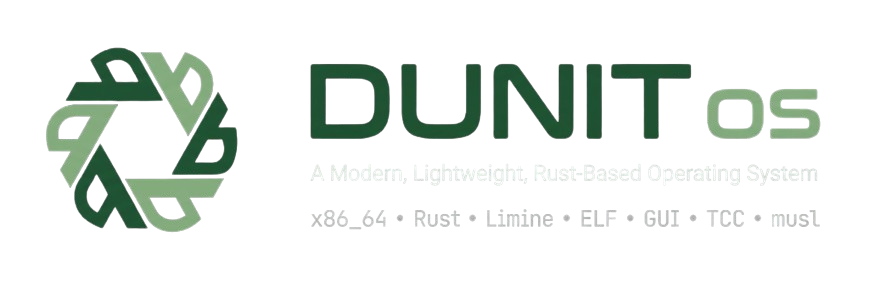
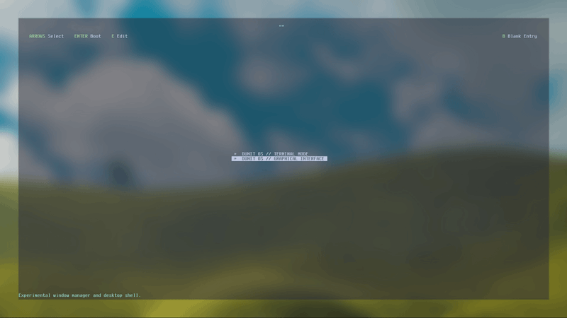
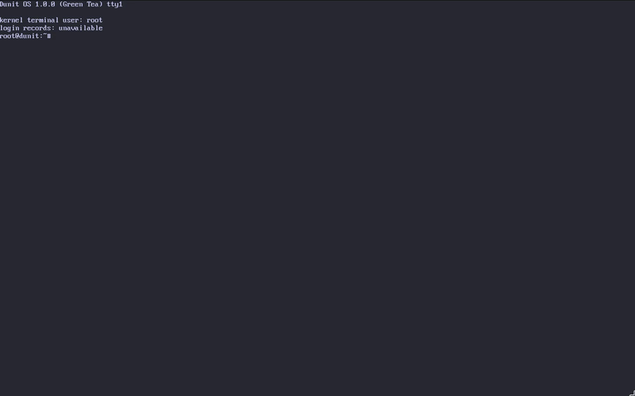
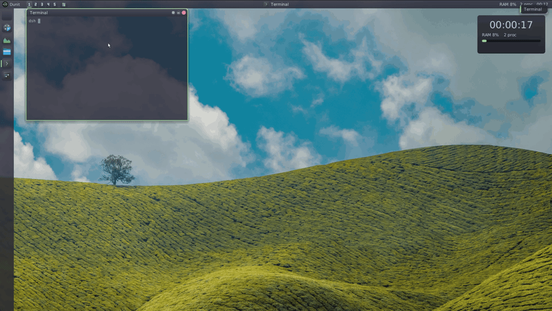

# Dunit OS



Dunit is an operating system we're building from scratch for x86_64 computers.
It has its own kernel, a terminal, a graphical desktop and a growing set of apps.
It's still an experimental project, but you can already boot it, explore the
system and make the desktop your own.

The kernel is written in Rust, with C and assembly handling the hardware layer.
The desktop and apps run as separate processes in userspace.

## The desktop is yours

DWM is Dunit's desktop environment. You can change its layout and behavior
without rebuilding the OS: keep a single bottom bar, add a second panel, move
things to another edge, or build a different arrangement altogether.

Panels are made of individual components. Put the launcher, workspaces, running
apps, clocks and system monitors where you want them. Group applications into
folders that open as a grid, a list or a fan. Add your own buttons and indicators.

Appearance is configurable too: TrueType fonts, colors, spacing, transparency,
blur, shadows and rounded corners. Settings lets you choose themes and profiles,
edit panels, set shortcuts and define window rules. Some of these pages expose
the configuration source directly.

Changes reload while the desktop is running. If a new configuration or its Lua
reload check fails, DWM keeps the previous working desktop.

## A little Lua goes a long way

Dunit includes Lua 5.5.1. You can use it to arrange windows, respond to desktop
events, update widgets and choose animations.

Here's a small example that fades in a new window:

```lua
local dwm = require("dwm")

dwm.on("window::created", function(win)
    dwm.animate(win, {
        property = "opacity",
        from = 0,
        to = 1,
        duration = 250,
        easing = "ease_out"
    })
end)
```

There are events for window focus, closing, minimizing and restoring, as well as
workspaces, panels, the launcher and widgets. Animations include fade, slide,
scale, spring and Genie. You can also write your own easing curves.

Lua describes what should happen; the native animation engine draws the frames.
Scripts run in separate processes with resource limits, so a script error can
fall back to the desktop's standard behavior.

Desktop customization uses three kinds of files:

- TOML for the layout, apps, shortcuts and window rules.
- DSS for appearance and style transitions.
- Lua for layouts, events, commands and animation behavior.

To try a complete example, choose a profile in Settings, or run this in the
Dunit terminal:

```text
exec /app/setup import-user /assets/dwm/frost-desktop.toml
```

[Frost](assets/dwm/frost-desktop.toml) has one full-width bottom panel. The
[multi-panel example](assets/dwm/multi-panel-desktop.toml) adds an auto-hidden
utility panel with an analog clock. Both use the bundled
[Lua event script](assets/dwm/scripts/events/macos.lua) and
[DSS theme](assets/dwm/styles/frost.dss).

For your own setup, see the [configuration guide](docs/architecture/dwm-shell.md)
and [Lua SDK reference](docs/DWM_LUA_SDK.md).

## What else is here?

The desktop comes with a terminal, file manager, calculator, Settings and a
system monitor. In the shell you'll find command history, tab completion,
`dufetch`, a calculator and filesystem tools. There's also a port of Tiny C
Compiler for building C programs inside Dunit.

Underneath, Dunit has preemptive scheduling, isolated address spaces, threads,
virtual memory protection and a static musl libc port for its native syscall
ABI. Limine handles BIOS and UEFI boot. Storage support includes AHCI SATA,
VirtIO block devices and DunitFS for persistent data.

The root filesystem currently lives in memory and is loaded from an external
initrd. Persistent files live on `/persist`. A user desktop profile at
`/persist/config/dwm.toml` overrides `/system/share/dwm/default.toml`; keeping it
across reboots requires a persistent `/persist` mount.

## Choose an image

New releases come in two editions:

- `dunit_dwm.iso` includes the graphical desktop, apps, Lua and the on-device
  C toolchain.
- `dunit_minimal.iso` boots straight to the terminal. It includes `dsh`,
  `dufetch`, `calc` and `fsck_dunit`, without DWM, desktop assets or the toolchain.

Both use the same kernel and native application ABI. The Minimal image keeps
an installer payload so it can still be installed from the live terminal.

## Build and try it

You'll need 64-bit Linux, `git`, `gcc`, `nasm`, `lld`, `xorriso`, `python3`,
`qemu-system-x86_64`, and nightly Rust with `rust-src`.

```bash
git clone --recurse-submodules https://github.com/DunitOS/dunit-os.git
cd dunit-os
rustup override set nightly
rustup component add rust-src
./build_iso.sh
```

The script builds both `build/dunit_dwm.iso` and `build/dunit_minimal.iso`.
Use `make iso-dwm` or `make iso-minimal` to build just one, or `make iso-release`
for both. `make disk-image` creates a BIOS/UEFI disk image.

See the [image build guide](docs/build-images.md) for composition, testing and
release details.

To build and check the desktop in QEMU:

```bash
python3 tools/qemu_test.py --build --config limine_test_gui.conf \
  --markers-file tools/gui_smoke_markers.json \
  --ready-marker 'gui_server: desktop ready' --timeout 300 --linger 8
```

## A look around

The boot menu:



The terminal:



The desktop:



## Still a work in progress

Dunit isn't ready to replace your everyday OS. It currently runs on one CPU
core. Networking, audio, dynamic linking, signals and a secure entropy service
are not ready yet.

The desktop uses software rendering, so large blur effects and lots of animated
surfaces can be expensive. There are limits of 64 panels and 512 components.
Genie uses a snapshot of the window during the animation, and clocks currently
show uptime rather than calendar time.

The [roadmap](DUNIT_OS_TECHNICAL_ROADMAP.md) tracks the next steps. More detailed
verification results are in the [desktop report](docs/DWM_ENGINE_V2_REPORT.md)
and [M6 report](docs/m6-readiness.md).

## Writing apps

Work on the native Rust SDK has started. It uses `no_std + alloc` over
`libdunit`, with an event loop that can wait for messages, files, timers and
child processes together. System Monitor uses that loop.
The SDK also handles files, buffered input, time and child processes. Calculator
now uses the [native application API](docs/sdk/native-api.md) and a normal Rust
entry function. [cargo dunit](docs/sdk/cargo-dunit.md) creates, builds, runs and
tests CLI/TUI apps on the Dunit kernel.
[Installed GUI manifests](docs/sdk/desktop-catalog.md) feed the launcher and dock.
GUI templates, widgets and CLI/TUI desktop launching are still being built.
See the [SDK progress and contract](docs/sdk/m7-start.md).

## Get involved

If you'd like to help build Dunit, take a look at the
[contributor guide](.github/CONTRIBUTING.md). Bug reports, reproducible test cases
and documentation improvements are welcome too.

## License

MIT.
