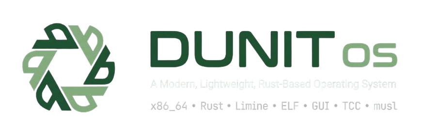
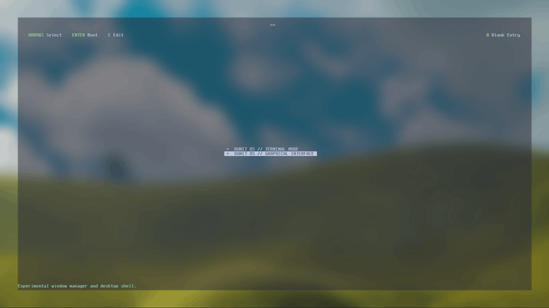
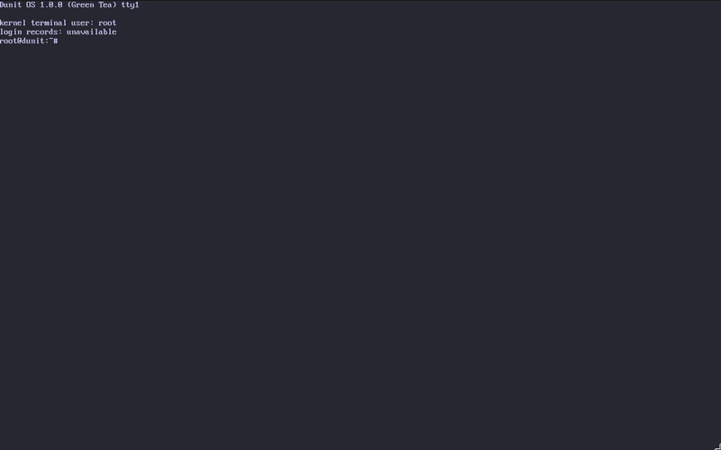
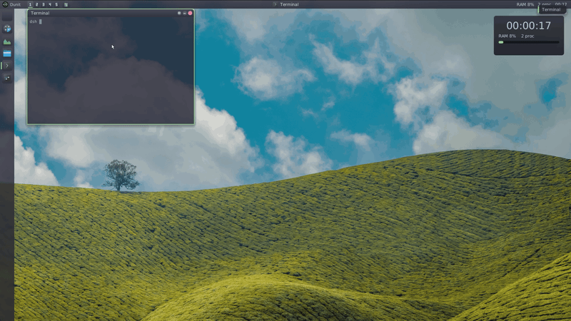

# Dunit OS

Dunit is an experimental operating system for x86_64 computers. It has a Rust
kernel, a C/NASM hardware layer, Limine BIOS/UEFI boot, a terminal and a userspace
desktop.

DWM includes Terminal, Files, Calculator, Settings and System Monitor. Panels,
apps, shortcuts and window rules use TOML; appearance uses DSS; Lua 5.5.1 workers
provide layouts, events, widgets and animations. Invalid reloads keep the
previous working desktop. Apps support text clipboard and scoped file transfers.

Applications use the native Dunit ABI. The Rust SDK uses no_std + alloc; static
musl and TinyCC support C programs. Root is currently MemFS populated from
initrd, with persistent data on DunitFS at `/persist`.

Application scheduling still uses one CPU. Networking, audio, full USB,
dynamic linking, signals and secure entropy remain incomplete. The desktop
uses software rendering, Genie animates a frozen snapshot, and clocks show
uptime.

See the [desktop manual](docs/architecture/desktop.md),
[SDK guide](docs/sdk/README.md) and [native ABI](abi/README.md).
[Current state](docs/architecture/current-state.md), the
[technical roadmap](DUNIT_OS_TECHNICAL_ROADMAP.md) and
[performance roadmap](DUNIT_OS_PERFORMANCE_ROADMAP.md) track implementation and
remaining work. Contribution rules are in the
[contributor guide](.github/CONTRIBUTING.md).

MIT. Bundled upstream code and assets retain their own licenses.
