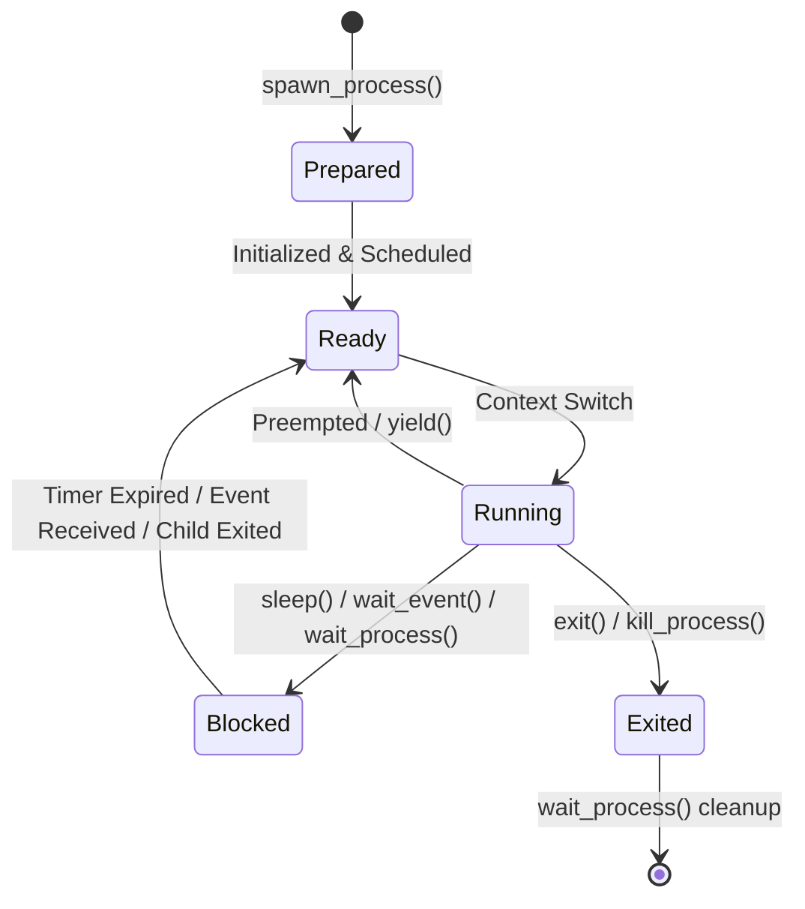

# System Architecture

This article provides an in-depth technical overview of the architecture of **Dunit OS (Green Tea)**. It describes the system layering, boot flow, hardware abstraction, memory management, process lifecycle, scheduler, threading model, and Inter-Process Communication (IPC).

---

## 1. System Layering & Boundaries

Dunit OS follows a modular microkernel-inspired design. System responsibilities are divided into strict layers with explicit hardware and software boundaries:

```text
+-------------------------------------------------------------------------+
|                        Userspace Applications                           |
|       Terminal, GUI Tools, Editors, Games (C/C++ & Rust ELFs)           |
+-------------------------------------------------------------------------+
                                    |
                                    v (Syscall ABI: RAX=Syscall, RDI..R9=Args)
+-------------------------------------------------------------------------+
|                  Desktop Environment & System Servers                   |
|     - DWM v2: Compositing window manager (DSS styling, Lua hooks)       |
|     - gui_server: Window transport, event multiplexing, UI kit          |
|     - VFS Service: MemFS root, Initrd unpacker, DunitFS v2 driver       |
+-------------------------------------------------------------------------+
                                    |
                                    v
+-------------------------------------------------------------------------+
|                       Dunit Kernel (Rust `no_std`)                      |
|     - Memory Management: PMM (Bitmap), VMM (PML4), Kernel Heap          |
|     - Process & Thread Subsystems: PCB, TCB, Address Spaces, FDs        |
|     - Scheduler: Preemptive Round-Robin, Timer IRQ, FPU/SSE (FXSAVE)    |
|     - IPC Subsystem: Per-PID byte message queues, Shared Memory Objects |
+-------------------------------------------------------------------------+
                                    |
                                    v (Direct C ABI function calls)
+-------------------------------------------------------------------------+
|                  Hardware Abstraction Layer (HAL - C/NASM)              |
|     - GDT & TSS: User/Kernel Segment Selectors                          |
|     - IDT: 256 Interrupt Gates, Exception Traps, PIC Remapping         |
|     - Low-level Syscall Entry Trampoline (`hal/src/syscall.asm`)        |
|     - Device Drivers: 8042 PS/2 Keyboard/Mouse, Bochs VBE, AHCI, e1000  |
+-------------------------------------------------------------------------+
                                    |
                                    v (Limine Boot Protocol)
+-------------------------------------------------------------------------+
|                           Limine Bootloader                             |
|          UEFI / BIOS Boot, HHDM Setup, Framebuffer Handover             |
+-------------------------------------------------------------------------+
```

---

## 2. Bootloader Protocol (Limine v5)

Dunit OS uses the **Limine Boot Protocol** (version 5). The kernel binary is built as a static 64-bit ELF executable (`build/kernel.elf`) placed in `/boot/` on the ISO image.

During system startup, Limine performs:
1. **CPU Initialization**: Sets up long mode (64-bit), initial page tables, and flat memory segmentation.
2. **Higher-Half Direct Map (HHDM)**: Maps all available physical memory into the kernel's higher-half virtual address space starting at offset `0xFFFF_8000_0000_0000`.
3. **Memory Map Delivery**: Provides an array of memory map entries classifying regions as `Usable`, `Reserved`, `ACPI Reclaimable`, `Bootloader Reclaimable`, or `Bad Memory`.
4. **Framebuffer Handoff**: Initializes the linear graphics framebuffer (e.g. 1920x1080x32 bpp or 1280x800x32 bpp) and passes the physical address, stride, resolution, and color masks to the kernel.
5. **Initrd Transfer**: Loads the initial ramdisk (`initrd.img`) into memory and delivers its physical location and length.

Upon completing setup, Limine jumps to the kernel entry point defined in `hal/src/entry.asm`.

---

## 3. Hardware Abstraction Layer (HAL)

The HAL lives in `hal/` and is written in C and NASM assembly. It isolates low-level CPU architectural mechanics from the Rust kernel.

### Global Descriptor Table (GDT)
The HAL installs a 64-bit GDT with five primary segment descriptors and a Task State Segment (TSS):
* `0x00`: Null descriptor
* `0x08`: Kernel Code Segment (64-bit, Ring 0, `0x00209A0000000000`)
* `0x10`: Kernel Data Segment (Ring 0, `0x0000920000000000`)
* `0x18`: User Code Segment (64-bit, Ring 3, `0x0020FA0000000000`)
* `0x20`: User Data Segment (Ring 3, `0x0000F20000000000`)
* `0x28`: Task State Segment (TSS descriptor, 16 bytes in long mode)

The TSS holds the `RSP0` pointer used by the CPU to switch stacks automatically when an interrupt or exception transitions execution from Ring 3 (userspace) to Ring 0 (kernel).

### Interrupt Descriptor Table (IDT)
The IDT contains 256 gates configured as 64-bit interrupt gates (`type = 0x8E`):
* **Vectors 0–31**: CPU Exceptions (Division By Zero `#DE`, Double Fault `#DF`, General Protection Fault `#GP`, Page Fault `#PF`, etc.).
* **Vectors 32–47**: Hardware IRQs remapped from the dual 8259 PIC controllers:
  * IRQ 0 (Vector 32): Programmable Interval Timer (PIT).
  * IRQ 1 (Vector 33): PS/2 Keyboard controller.
  * IRQ 12 (Vector 44): PS/2 Mouse controller.
* **Vector 128 (0x80)**: Legacy trap gate (reserved).

### Syscall Trampoline
The fast system call interface uses the x86_64 `syscall` instruction. In `syscall_init`, the HAL programs the Model-Specific Registers (MSRs):
* `IA32_EFER`: Enables System Call Extensions (bit `SCE`).
* `IA32_STAR`: Encodes the target kernel code selector (`0x08`) and user base selector (`0x18`).
* `IA32_LSTAR`: Points to the assembly entry point `syscall_entry` in `hal/src/syscall.asm`.
* `IA32_SFMASK`: Masks flags on entry (specifically clearing `IF` to disable interrupts during transition).

---

## 4. Memory Management Subsystem

The memory subsystem is divided into three tiers: physical, virtual, and heap.

### Physical Memory Manager (PMM)
The PMM (`kernel/src/memory/pmm.rs`) operates as a bitmap frame allocator:
* It parses the Limine memory map to register all contiguous physical blocks marked as `LIMINE_MEMMAP_USABLE`.
* Each physical frame of 4 KiB corresponds to a single bit in an in-memory allocation bitmap.
* Allocation operations find the first free bit (`alloc_frame`), set it, and return the physical address. Deallocation (`free_frame`) clears the bit.
* Early boot structures and kernel binaries are marked as allocated to prevent overwriting.

### Virtual Memory Manager (VMM)
The VMM (`kernel/src/memory/vmm.rs`) manages x86_64 4-level paging (`PML4` -> `PDPT` -> `PD` -> `PT`):
* **Kernel Space**: The upper half of the virtual address space (canonical addresses `>= 0xFFFF_8000_0000_0000`) is shared across all processes. This includes the HHDM, kernel text/data, and heap mappings.
* **User Space**: The lower canonical range (`0x0000_0000_0000_0000` to `0x0000_7FFF_FFFF_FFFF`) is unique per process. Every process owns its private PML4 root page table.
* **AddressSpace Abstraction**: Handles page mapping (`map_page`), unmapping (`unmap_page`), protection flags (`PROT_READ`, `PROT_WRITE`, `PROT_EXEC`), and page directory switching via the `CR3` control register.
* **Guard Pages**: Supports guarded virtual allocations (`MAP_GUARD`) where allocation ranges are bounded by non-present pages to catch stack and buffer overruns immediately.

### Kernel Heap
The kernel heap (`kernel/src/memory/heap.rs`) provides dynamic memory allocation for Rust standard collections (`alloc::vec::Vec`, `alloc::string::String`, `alloc::boxed::Box`, `alloc::sync::Arc`):
* Implemented as a growable linked-list allocator backed by physical frames requested on-demand from the PMM.
* Handles fragmentation through bucketed slabs and coalescing free-block lists.

---

## 5. Process Lifecycle & Scheduler

Dunit OS implements honest process accounting and preemptive multitasking.

### Process Control Block (PCB)
Each process is represented by a `Process` structure:
```rust
pub struct Process {
    pub pid: Pid,
    pub parent_pid: Option<Pid>,
    pub state: ProcessState,
    pub address_space: AddressSpace,
    pub fd_table: FdTable,
    pub cwd: String,
    pub exit_code: Option<i32>,
    pub registers: CpuRegisters,
    pub fpu_state: FpuState, // 512-byte FXSAVE buffer
    pub ipc_queue: MessageQueue,
}
```

### Process State Machine



* **Prepared**: Allocated and initialized in memory, ELF binary loaded, but not yet scheduled.
* **Ready**: Placed in the scheduler run-queue waiting for an available CPU time-slice.
* **Running**: Currently executing on the CPU in Ring 3 (or in Ring 0 during a syscall).
* **Blocked**: Suspended awaiting an external event, sleep deadline, or child termination.
* **Exited**: Execution completed; exit code retained until harvested by parent process.

### Preemptive Scheduler
The scheduler (`kernel/src/process/scheduler.rs`) implements round-robin scheduling:
* **Timer Preemption**: The Programmable Interval Timer (PIT) triggers IRQ 0 at 100 Hz. The interrupt handler decrements the running process's remaining quantum. If expired, it triggers a preemptive context switch.
* **Context Switching**: The kernel saves General Purpose Registers (GPRs) onto the process's kernel stack and executes `fxsave` to preserve SSE/AVX/x87 floating-point registers. It then swaps `CR3` to the next process's page table and restores state via `fxrstor` and `IRETQ`.
* **Cooperative Yield**: Processes can voluntarily yield remaining execution time via `sys_yield()`.

---

## 6. Threading Model

Processes support multiple threads of execution (`kernel/src/process/thread.rs`):
* **Thread Control Block (TCB)**: Each thread has a unique Thread ID (`TID`), its own CPU register context, kernel interrupt stack, and floating-point state.
* **Shared Resources**: All threads within a process share the same `AddressSpace`, file descriptor table, and current working directory.
* **Thread-Local Storage (TLS)**: Syscall `set_thread_pointer` (syscall 39) programs the CPU `IA32_FS_BASE` MSR, enabling C/Rust userspace runtimes to maintain per-thread pointers (`FS:0`).
* **Primitives**:
  * `thread_create(entry, stack_top, arg)`: Spawns a secondary thread.
  * `thread_join(tid, status)`: Waits for a thread to complete and harvests its exit status.
  * `thread_exit(code)`: Terminates the calling secondary thread.

---

## 7. Inter-Process Communication (IPC)

Dunit OS provides two complementary IPC mechanisms:

### Byte Message Queues
* Every process possesses an asynchronous, bounded FIFO byte message queue.
* `send_message(target_pid, msg, len)` copies a message of up to 4 KiB directly into the recipient's queue.
* `receive_message(buf, len)` retrieves the next available message. If the queue is empty, it returns `EAGAIN` without blocking.
* `wait_event(timeout_ms)` transitions the calling process to `Blocked` until a new message arrives or the timeout expires.

### Shared Virtual Memory Objects
For high-bandwidth bulk data transfer (e.g. video frames, audio buffers, window surfaces):
* `shared_vm_create(len)` allocates an anonymous shared memory object backed by zero-filled physical frames (up to 16 MiB) and returns an object handle.
* `shared_vm_map(obj_id, addr, prot)` maps the shared physical frames into the virtual address space of the calling process.
* Multiple processes mapping the same object handle share identical physical frames without data copying.
* `shared_vm_close(obj_id)` decrements the reference count and deallocates frames when all mappings are released.

